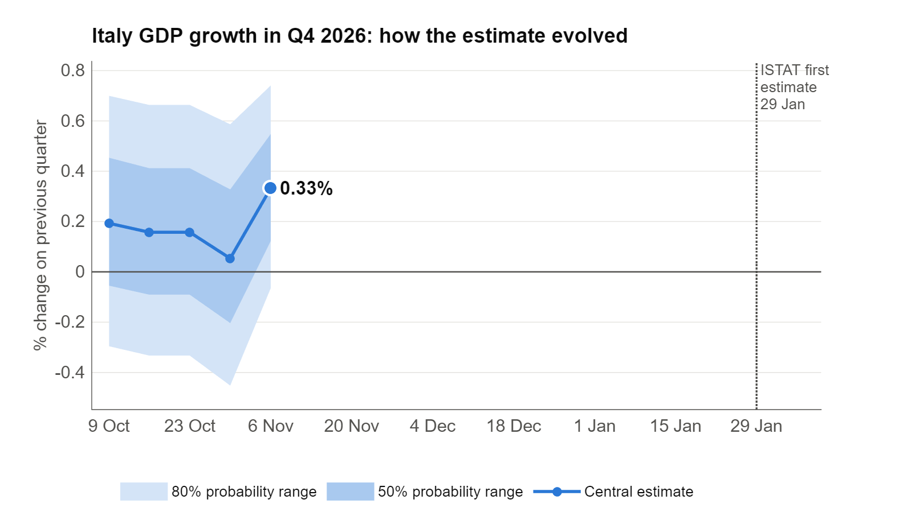
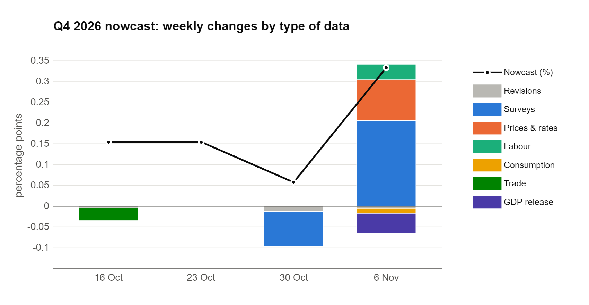
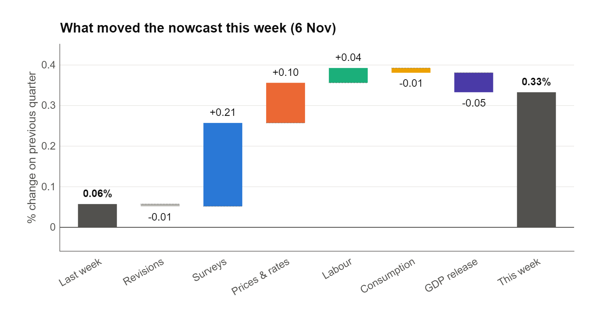
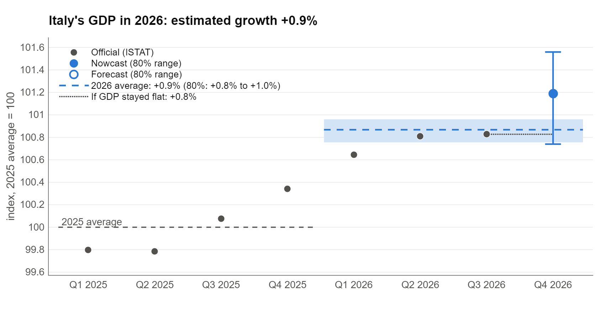
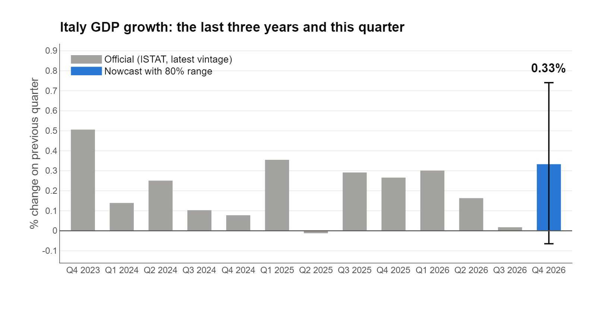
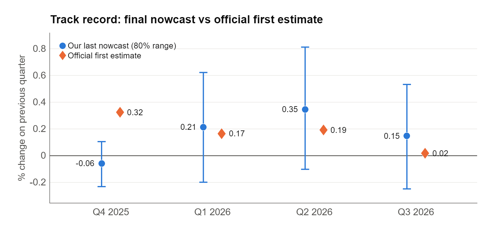
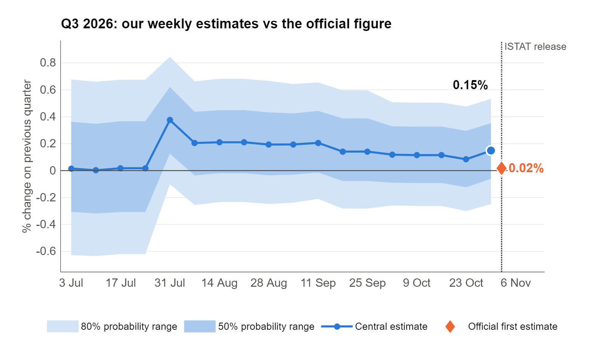
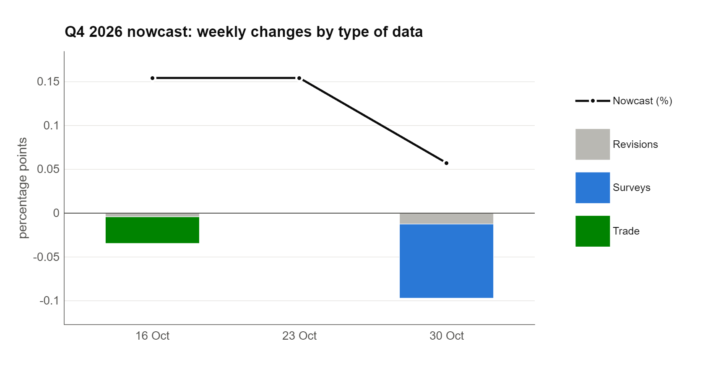
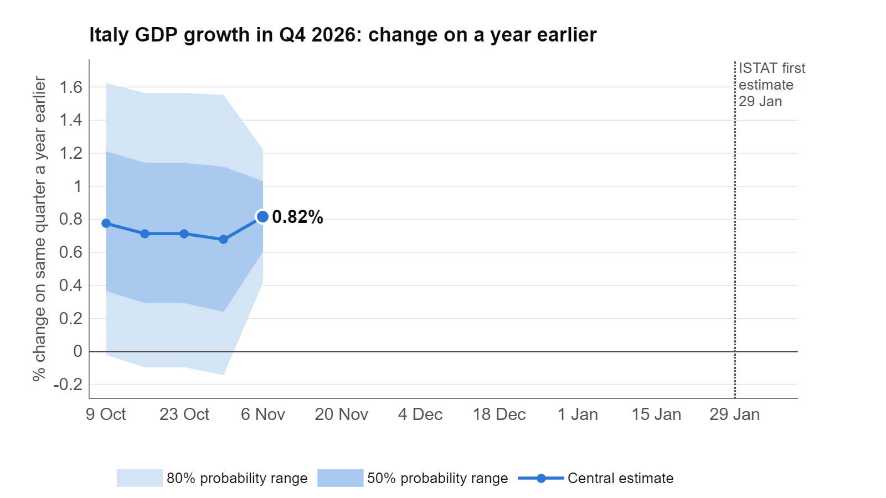

**Latest estimate, 6 November 2026 at 12:02:** Italy's real GDP in **Q4 2026** is growing by **0.33%** compared with the previous quarter.
Likely range (80% probability): -0.06% to 0.74%. Compared with a year earlier: 0.82%.
The estimate is up 0.28 percentage points from last week.
{: .notice--primary style="font-size: 1.1em !important; line-height: 1.6;"}

<!-- release-update -->

*Updated every Friday. Next official figure: ISTAT preliminary estimate for Q4 2026, due 29 January 2027.*


{{ itnow_block | markdownify }}

## How the estimate for Q4 2026 has evolved

Each point is the estimate made on that Friday with the data available at the time. The shaded bands show the uncertainty: the darker band contains the outcome with 50% probability, the lighter band with 80%. The bands narrow as more monthly data for the quarter are published.

Each bar shows how much the data published that week moved the nowcast, split by type of data. Grey bars are revisions to figures published earlier.

This week's changes in detail

The data published this week moved the estimate by +0.28 percentage points (surveys +0.21, prices & rates +0.10, gdp release -0.05).

*Contributions are computed with the model: each group of releases is added in turn and the change in the average nowcast is recorded. Totals can differ from the headline figure, a median, by a few hundredths.*

New data published since last week:

- Consumer confidence (Oct 2026): -0.1 points
- Industrial confidence (Oct 2026): +0.2 points
- Consumer prices (HICP) (Oct 2026): +1.2% on previous month
- 1-year Euribor interest rate (Oct 2026): -0.01 percentage points
- Retail sales (volume) (Sep 2026): +0.1% on previous month
- Unemployment rate (Sep 2026): +0.10 percentage points
- Real GDP (Q3 2026): published

## GDP growth in 2026

**Estimate for 2026 as a whole: 0.87%** (80% range 0.76% to 0.96%), with the data available on 6 November 2026.

If GDP stayed at its Q3 2026 level for the rest of the year, growth in 2026 would be 0.78% (the carry-over, or *crescita acquisita*, also reported by ISTAT). The nowcast for Q4 2026 adds +0.09 points.

*Annual growth is the average GDP level of the four quarters over the average of the previous year, using seasonally and calendar-adjusted quarterly data. ISTAT's annual figure is not adjusted for the number of working days and can differ by one or two tenths. Quarters still to come are model forecasts, so their range is wider.*

## In context

Historical Italy GDP growth

Grey bars are official ISTAT figures (latest available vintage); the blue bar is this week's nowcast with its 80% range.

## How accurate has the nowcast been?

Nowcast accuracy

Every quarter we compare our last estimate before the official release with ISTAT's first estimate. Nowcasts are estimates made with incomplete real-time information.

| Quarter | Our last nowcast | 80% range | ISTAT first estimate | Difference |
|---|---:|---:|---:|---:|
| Q3 2026 | 0.15% | -0.25% to 0.53% | 0.02% | +0.13 pp |
| Q2 2026 | 0.35% | -0.10% to 0.81% | 0.19% | +0.15 pp |
| Q1 2026 | 0.21% | -0.20% to 0.62% | 0.17% | +0.05 pp |
| Q4 2025 | -0.06% | -0.23% to 0.11% | 0.32% | -0.38 pp |

Each bar shows how much the data published that week moved the nowcast, by type of data.

## About the model

Mixed-Frequency Bayesian VAR (MF-BVAR)


{{ itnow_block | markdownify }}

## Details

Weekly estimates for this quarter

| Estimate made on | Quarter-on-quarter | 80% range | Year-on-year |
|---|---:|---:|---:|
| 6 November 2026 | 0.33% | -0.06% to 0.74% | 0.82% |
| 30 October 2026 | 0.05% | -0.45% to 0.59% | 0.68% |
| 23 October 2026 | 0.16% | -0.33% to 0.66% | 0.71% |
| 16 October 2026 | 0.16% | -0.33% to 0.66% | 0.71% |
| 9 October 2026 | 0.19% | -0.30% to 0.70% | 0.78% |

Data releases since the start of the quarter

| Week of | Indicator | Data for | Change on previous period |
|---|---|---|---:|
| 6 November 2026 | Consumer confidence | Oct 2026 | -0.1 points |
| 6 November 2026 | Industrial confidence | Oct 2026 | +0.2 points |
| 6 November 2026 | Consumer prices (HICP) | Oct 2026 | +1.2% on previous month |
| 6 November 2026 | 1-year Euribor interest rate | Oct 2026 | -0.01 percentage points |
| 6 November 2026 | Retail sales (volume) | Sep 2026 | +0.1% on previous month |
| 6 November 2026 | Unemployment rate | Sep 2026 | +0.10 percentage points |
| 6 November 2026 | Real GDP | Q3 2026 | published |
| 30 October 2026 | Consumer confidence | Sep 2026 | -3.0 points |

Revisions to previously published data

| Week of | Indicator | Data for | Old value | New value |
|---|---|---|---:|---:|
| 16 October 2026 | Consumer prices (HICP) | Sep 2026 | 4.65 | 4.65 |

Indicators used

| Indicator | Frequency | Source | Enters the model as |
|---|---|---|---|
| Retail sales (volume) | Monthly | EUROSTAT | log level |
| Unemployment rate | Monthly | EUROSTAT | level |
| Consumer confidence | Monthly | EUROSTAT | level |
| Industrial confidence | Monthly | EUROSTAT | level |
| Industrial production | Monthly | EUROSTAT | log level |
| Industrial production in Germany | Monthly | EUROSTAT | log level |
| Consumer prices (HICP) | Monthly | EUROSTAT | log level |
| 1-year Euribor interest rate | Monthly | ECB | level |
| Exports | Monthly | ISTAT | log level |
| Imports | Monthly | ISTAT | log level |
| Real GDP | Quarterly | EUROSTAT | log level |

---

*IT Now is an independent research project by [Filippo Ferroni](/) (University of Bologna). It is not an official statistic and does not represent the views of any institution. It is not investment advice.*

<small>Page generated automatically on 06 Nov 2026 12:02.</small>
